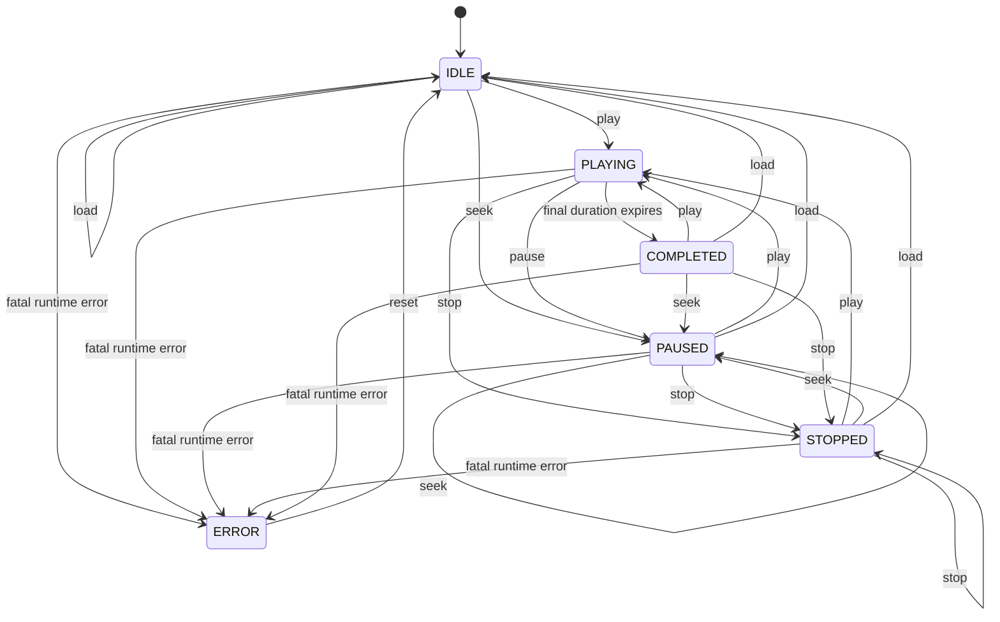

# State Machine: `@rsvp-engine/core`

| State | Meaning | Position |
| --- | --- | --- |
| `IDLE` | Ready but not presenting. | Selected index `0`, progress `0`. |
| `PLAYING` | Current item is visible and advancement is scheduled. | Current visible item. |
| `PAUSED` | Current item remains selected; remaining time is preserved. | Unchanged. |
| `STOPPED` | Playback cancelled and reset. | Index `0`, progress `0`. |
| `COMPLETED` | Final item finished its display duration. | `length - 1`, progress `1`. |
| `ERROR` | A fatal failure made playback unsafe. | Empty after fatal loading; otherwise retained. |

## Pause and resume

Pause preserves the current item's remaining display time using the scheduler's effective deadline, when available. Resume schedules that remainder. If it has already expired, resume advances to the next item or enters `COMPLETED` for the final item, publishing one `advanced` or `completed` notification. See [duration estimates](./API-REFERENCE.md#duration-estimates).

## Stop behavior

`stop()` retains loaded items and never starts playback or retokenizes input:

| Starting state | Result |
| --- | --- |
| `IDLE`, including empty input | No-op; retains the ready state and cached snapshot. |
| `PLAYING` or `PAUSED` | Cancels playback and enters `STOPPED` at index `0`, progress `0`, and full remaining duration. |
| `STOPPED` | No-op; repeated calls retain the cached snapshot. |
| `COMPLETED` | Enters `STOPPED` at index `0`, progress `0`, and full remaining duration. |
| `ERROR` | Throws `InvalidTransitionError`; fatal state and loaded items remain. Recovery still requires `reset()`. |

No-op calls do not notify or resample timing; an observable Stop publishes one `stopped` update. See [ADR-0011](./architecture/adr/0011-retained-session-controls.md).

## Error policy

Synchronous command failures throw to their caller; timer and isolated subscriber failures use `onError` or asynchronous host reporting. Snapshots contain playback state only. Invalid controls preserve the cached snapshot without notifying; fatal failures cancel advancement, enter `ERROR`, and publish `stateChanged` before error delivery. Only `reset()` recovers playback. See the [error contract](./API-REFERENCE.md#errors) and [ADR-0018](./architecture/adr/0018-caller-owned-errors-and-playback-snapshots.md).

The low-level `StateMachine.transition()` throws `InvalidTransitionError` for an illegal action. Fatality is preserved across engine-error causes, so an ordinarily nonfatal operation can still enter `ERROR` when its failure has a fatal cause. See [ADR-0017](./architecture/adr/0017-typed-engine-errors.md).

Fatal tokenization or loading failures clear the session before publishing `ERROR`: selection becomes empty and position, item count, progress, and total duration become zero. Speed and OVP preferences survive. Nonfatal validation failures preserve the session; fatal playback or navigation failures retain the last valid selection and progress. See [ADR-0016](./architecture/adr/0016-clear-failed-loads.md).

Without a configured tokenizer, `load()` throws nonfatal `MissingTokenizerError` and preserves the session and cached snapshot. `loadTokens()` needs no tokenizer. Loading restrictions in `PLAYING` and `ERROR` still apply.

Nonfatal `setOvpStrategy()` failures preserve the prior strategy, selected item, and scheduling. Presentation failures during later selection enter `ERROR`; selection during loading follows the clearing policy above. The setter is rejected in `ERROR`. See [runtime OVP preferences](./API-REFERENCE.md#runtime-ovp-preferences).

Clock and cancellation failures are fatal. Reporting retains the last successful timing sample, invalidates stale callbacks, and preserves the original error when cleanup also fails. Subscriber and diagnostic transport failures do not enter playback error handling. See [ADR-0020](./architecture/adr/0020-failure-safe-error-reporting.md).

## Navigation

`seek()` accepts only finite integers in `[0, totalItems)`. Invalid indices throw `IndexOutOfBoundsError` before checking state and preserve selection, progress, and scheduling, including a paused item's remaining display time. Empty input has no valid seek index. Valid seek states are `IDLE`, `PAUSED`, `STOPPED`, and `COMPLETED`.

A valid seek enters `PAUSED`, selects the item with its full display period, and schedules nothing. This also permits choosing an initial position before the first playback. Progress becomes `index / totalItems`, excluding the selected item. Progress reaches `1` after the final item's display period ends; fatal playback or navigation errors retain the last published progress. `play()` continues from the selected item; `next()` and `previous()` remain available only while `PAUSED`. Seek is invalid in `PLAYING` and `ERROR`.

## Destruction

`destroy()` permanently ends the instance lifetime outside the playback state machine. It cancels playback and clears session buffers, listeners, and pending notifications without publishing an update. Cleanup finishes even if cancellation fails, then throws that failure. Subsequent commands and new subscriptions throw `EngineDestroyedError`. Post-destroy reads are unsupported and unguarded; capture required snapshots beforehand and stop reading the instance. Repeated destroy and existing unsubscribe functions remain safe. See [ADR-0014](./architecture/adr/0014-terminal-destruction.md).

## Invariants

1. Leaving `PLAYING` invalidates scheduled callbacks and attempts to cancel the pending task.
2. Pause/resume preserves the remaining display time.
3. Seek is unavailable during playback and selects an item in `PAUSED`.
4. Loading replacement data is unavailable in `PLAYING` and `ERROR`.
5. Only `reset()` exits `ERROR`, clearing loaded data and returning to `IDLE`.
