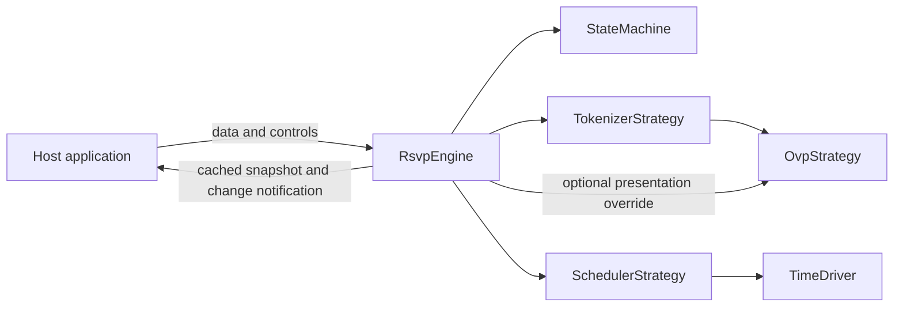

# Architecture: `@rsvp-engine/core`

Durable architectural decisions are recorded in the [ADR index](./adr/README.md).

The package is a synchronous, observable Rapid Serial Visual Presentation (RSVP) playback engine. Host applications own rendering, storage, visibility handling, and asynchronous data acquisition.



## Invariants

- No production dependencies.
- No DOM APIs; code must run in Node.js, workers, React Native, and browser threads.
- Keep the bundle within the [size budget](../../scripts/check-bundle-size.js).
- TypeScript strict mode and native `#privateField` encapsulation.
- Preserve the [coverage thresholds](../../vitest.config.ts) and [simulated scheduling guarantees](../../src/scheduler/drift-corrected-scheduler.test.ts).

## Playback model

`currentIndex` is the presented item, not the next scheduling cursor. A fresh `play()` presents index zero immediately, then schedules advancement using that item's multiplier. Pause stores the effective deadline delta; resume schedules that remaining duration or advances immediately when it has expired. Completion occurs only after the last item's display duration expires.

The engine retains frozen source `Token<T, TMeta>` copies and derives the selected `RsvpItem<T, TMeta>` presentation without overwriting initial offsets. The two names share a structural type; position belongs to the engine and snapshot rather than the item. See [ADR-0015](./adr/0015-position-independent-presentation-items.md). Metadata remains application-owned and travels by reference with a fixed type that determines its presence; see [ADR-0021](./adr/0021-consumer-defined-token-metadata.md).

Construction validates and assigns configuration directly, then creates timing and the snapshot once without calling public setters. It starts empty. Tokenizers are optional independently of metadata: `load()` requires an explicitly supplied converter, while `loadTokens()` does not. A missing tokenizer is a nonfatal command failure that preserves the session. React keeps empty content in its construction-time server snapshot; see [ADR-0022](./adr/0022-explicit-content-loading.md).

Cached duration samples use duration-multiplier suffix sums: O(n) preparation on loading, then O(1) calculations on playback and speed changes. The application owns countdown rendering; see [ADR-0010](./adr/0010-event-sampled-playback-timing.md).

Synchronous command failures throw typed engine errors; timer and listener failures use `onError` or asynchronous host reporting. Snapshots contain playback state only. Nonfatal rejected commands preserve playback without notifying; fatal failures cancel advancement and publish `ERROR` before error delivery. See [error types](./adr/0017-typed-engine-errors.md) and [caller ownership](./adr/0018-caller-owned-errors-and-playback-snapshots.md).

Loading validates tokens, installs them, and prepares the first item through the shared selection operation. Fatal loading failures discard session data while preserving preferences; playback and navigation failures retain the last valid selection. See [ADR-0016](./adr/0016-clear-failed-loads.md).

Publication prepares the snapshot and delivers notifications together. Subscriber failures are isolated from other listeners and engine fatality, while diagnostic transport failures preserve committed playback. Fatal reporting remains possible when clock reads or cancellation fail. See [listener isolation](./adr/0019-isolated-listener-error-reporting.md) and [failure boundaries](./adr/0020-failure-safe-error-reporting.md).

Destroy permanently ends the instance lifetime and clears session buffers and subscriptions. Commands and new subscriptions then fail; callers are responsible for stopping all reads. Previously captured snapshots remain valid. See [ADR-0014](./adr/0014-terminal-destruction.md).

## Dependency injection

- `TokenizerStrategy<T, TMeta>` converts synchronous input into `Token<T, TMeta>[]`, including initial offsets, duration multipliers, and application metadata whose presence follows `TMeta`.
- `OvpStrategy` selects a UTF-16 viewing-position offset. A tokenizer strategy runs during tokenization; an independent, optional engine strategy overrides the selected string's presentation.
- `SchedulerStrategy` controls delayed task execution.
- `TimeDriver` supplies the monotonic clock and timer host.

`SystemTimeDriver` uses `performance.now()` when the host provides it and falls back to `Date.now()`. Its `setTimeout` and `clearTimeout` globals are required capabilities in the default browser, worker, Node.js, and React Native hosts. Timerless embedded or worklet environments must inject a compatible `TimeDriver` instead of using the default.

Async NLP or remote tokenization stays outside the core:

```typescript
const tokens = await externalTokenizer(text);
engine.loadTokens(tokens);
```

This keeps construction, state transitions, tests, and snapshots deterministic.

## Scheduling decision

Ordinary event-loop lag is subtracted from the next delay to prevent cumulative drift. If lag is at least one entire interval, the scheduler rebases instead of scheduling immediate catch-up ticks. Readability takes precedence over catching up every missed deadline.

Browser background throttling is outside the headless core. Browser hosts should pause on visibility loss and resume when appropriate.

## Unicode decision

`TextTokenizer` accepts strings and flat text arrays, segments each text independently, and rejects other input. Applications use prepared tokens or their own tokenizer for generic items; see [ADR-0023](./adr/0023-text-only-built-in-tokenizer.md). It feature-detects `Intl.Segmenter` for Unicode word boundaries. A whitespace fallback keeps older runtimes functional. `DefaultOvpStrategy` reuses a grapheme segmenter per instance, with a dependency-free fallback for combining marks and ZWJ emoji, while returning UTF-16 offsets compatible with JavaScript string slicing. A custom strategy can be injected into `TextTokenizer` for initial offsets, or into the engine for per-item presentation overrides that preserve pre-tokenized offsets; see [ADR-0012](./adr/0012-persistent-ovp-preferences.md).
